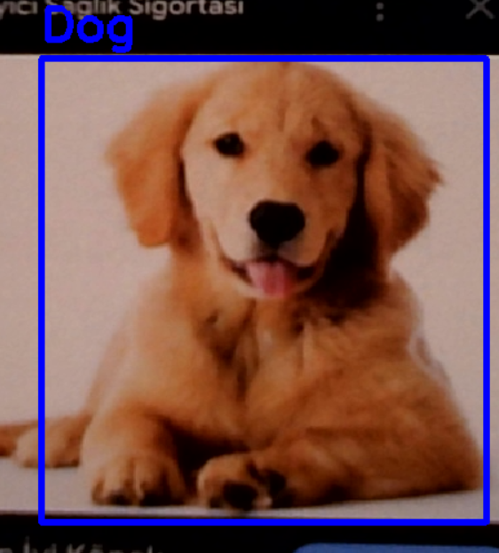
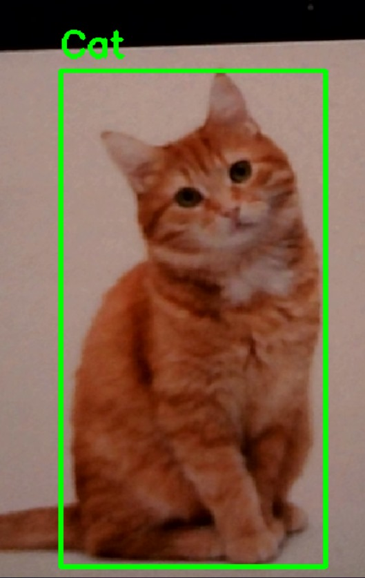

# Evcil Hayvan Tanıma Sistemi (Kedi / Köpek)

YOLOv5 modelini kullanarak kamera görüntüsünde gerçek zamanlı **kedi ve köpek tespiti** yapan bir yapay zekâ / görüntü işleme öğrenci projesi.

Projenin tüm kodu tek bir betikten oluşur: [`pet_detection.py`](pet_detection.py). Hazır eğitilmiş YOLOv5s modelini kullandığı için ayrıca veri seti ya da eğitim adımı yoktur.

## Çalıştırma

```bash
pip install torch torchvision opencv-python pandas
python pet_detection.py
```

İlk çalıştırmada model `torch.hub` üzerinden otomatik indirilir (internet gerekir). Bilgisayara bağlı bir kamera gerekir; pencereyi kapatmak için `q` tuşuna basın.

## Çıktı örnekleri

Tespit edilen hayvanın etrafına kutu çizilir ve üzerine `Cat` (yeşil) veya `Dog` (mavi) etiketi yazılır.

| Köpek tespiti | Kedi tespiti |
|---|---|
|  |  |

## Sistem ne yapıyordu?

- Kameradan (Full HD, 1920x1080 olarak ayarlanmış) görüntü alır.
- Önceden eğitilmiş **YOLOv5s** modelini `torch.hub` üzerinden yükler.
- Yalnızca kedi ve köpek sınıflarını tutar (COCO sınıf numaraları 15 ve 16) ve minimum güven skorunu 0,5 olarak belirler.
- Tespit edilen hayvanın etrafına kalın bir kutu çizer; kedi için yeşil, köpek için mavi renk ve `Cat` / `Dog` etiketi kullanır.
- Görüntüyü 1280x720 boyutunda bir pencerede gösterir; `q` tuşuyla kapanır.

## Projenin amacı

- Evcil hayvan sahipleri için otomatik tanıma sistemi geliştirmek
- Hayvan barınaklarında otomatik sınıflandırma yapmak
- Akıllı ev sistemlerinde evcil hayvan takibi sağlamak

## Hedef kullanıcı kitlesi

Veteriner klinikleri, hayvan barınakları, hayvan sahipleri ve yapay zekâ ile görüntü işlemeyi öğrenmek isteyen öğrenciler.

## Kullanılan teknolojiler

- Python 3.10
- PyTorch
- YOLOv5s (önceden eğitilmiş model)
- OpenCV

## Poster

Proje posteri Canva ile hazırlandı: [Posteri görüntüle](https://www.canva.com/design/DAGoWA2-MxQ/KBzdlf-JOPaBVWPzk27B8A/edit?utm_content=DAGoWA2-MxQ&utm_campaign=designshare&utm_medium=link2&utm_source=sharebutton)

## Depo içeriği

- `pet_detection.py`: gerçek zamanlı tespit betiği
- `gorseller/`: örnek tespit çıktıları

## Geliştirici

Alptekin Zengin
